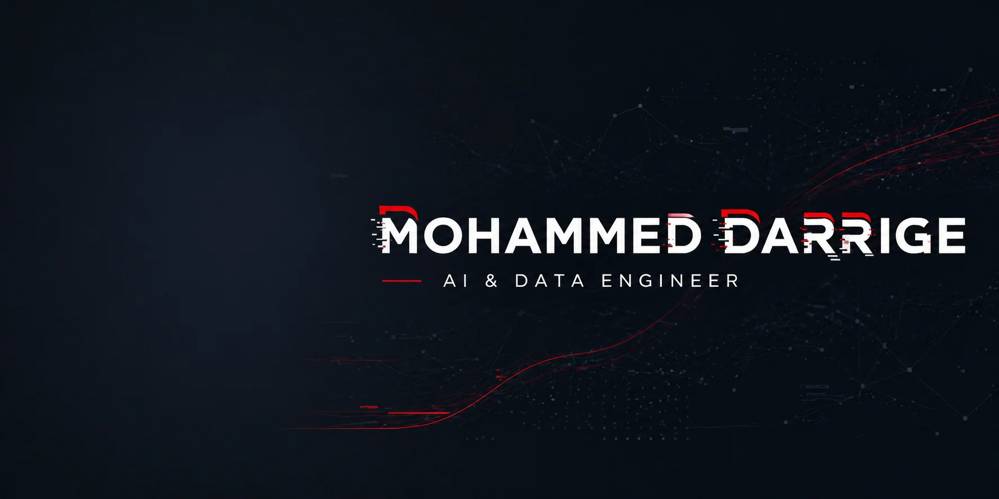

# Mohammed Darrige

Applied AI & Data Engineer building reproducible RAG pipelines, fine-tuned diffusion workflows, and deterministic inference engines.

  

## Focus

- **Applied NLP & RAG:** Hybrid retrieval (Okapi BM25 + Multilingual-E5 + RRF), Turkish NLU, and numeric-grounding verification for local LLMs.
- **Generative Vision:** Stable Diffusion 1.5 rank-4 UNet LoRA fine-tuning, SHA-256 artifact manifests, and FastAPI inference serving.
- **Deterministic Inference:** Constraint-consistent Bayesian deduction with bounded information-gain lookahead.
- **Languages:** Arabic (Native), Turkish (Professional), English (B2).
- **Portfolio:** [darrige.tech](https://darrige.tech) · **Kaggle:** [muhammedderric](https://www.kaggle.com/muhammedderric)

## Stack

## Flagship Repositories

### [Turkish Customer Support Voice & Text RAG Assistant](https://github.com/Mohammed-Darrige/turkish-customer-nlu-rag)

End-to-end Turkish customer support assistant combining Okapi BM25, `multilingual-e5-small`, Reciprocal Rank Fusion (`k=60`), rule-based NLU, and local Ollama numeric-grounding checks.

- **Measured Retrieval (`N=21`):** Hybrid Hit@1 **85.7%** (`18/21`), MRR@3 **0.881**, mean latency **8.96 ms**.
- **Stack:** Python, FastAPI, Docker, `sentence-transformers`, Web Speech API (`tr-TR`), `pytest`, GitHub Actions CI.

### [Neural Style Transfer (SD 1.5 LoRA + FastAPI)](https://github.com/Mohammed-Darrige/neural-style-transfer)

Stable Diffusion 1.5 text-to-image and image-to-image style transfer with three deployed rank-4 UNet LoRA adapters: Cubism, Post-Impressionism, and Ukiyo-e.

- **Verified Artifacts:** 3.08 MiB `.safetensors` adapters with SHA-256 manifests and preserved Colab training provenance.
- **Live Demo:** [darrige.tech/projects/neural-style-lab](https://darrige.tech/projects/neural-style-lab)

### [Deterministic Bayesian Akinator v4](https://github.com/Mohammed-Darrige/ai-akinator)

Deterministic animal deduction engine with strict direct-observation consistency, 110 catalogue targets, 90 `tr/en/ar` questions, and two-question information-gain lookahead.

- **In-Sample Benchmark:** **330/330** solved (`7.11` mean questions, `4.96 ms` mean selector time).
- **Live Demo:** [darrige.tech/projects/ai-akinator](https://darrige.tech/projects/ai-akinator)

### [Artoria Dataset](https://www.kaggle.com/datasets/h7alasaleh/artoria-dataset)

Curated art-movement dataset used in the Style Transfer LoRA training workflow.

## Contact

