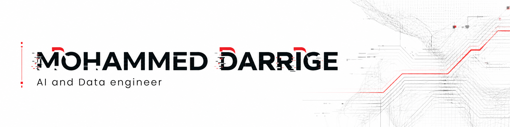

# Mohammed Darrige

Deep Learning · Computer Vision · Applied AI

Third-year Artificial Intelligence and Data Engineering student at Fırat University. I work on understanding how models behave beneath the surface and turning ideas into reliable systems.

  

## About

I co-founded DIYAK, an NLP and AI research club, where I coordinate R&D workflows, weekly paper readings, and applied student research. Outside university, I work through competitive machine learning as a Kaggle Notebooks Expert (top 3%) and build applied AI projects from data preparation to evaluation.

I speak Arabic natively, Turkish at a full professional level, and English at a professional working level. Live demos are at [darrige.tech](https://darrige.tech), and notebooks are on [Kaggle](https://www.kaggle.com/muhammedderric).

## Focus areas

- Machine learning and deep learning architectures
- Computer vision and parameter-efficient generative modeling
- Natural language processing, retrieval systems, and Turkish NLP
- Multimodal speech and text modeling
- Data quality, leak-free validation, and systematic model evaluation

## Selected work

### [Turkish Customer Support Voice and Text RAG](https://github.com/Mohammed-Darrige/turkish-customer-nlu-rag)

A Turkish customer support retrieval system over 213 chunks of Turkish Consumer Law (Law No. 6502 and related regulations). It combines dense vector search with Turkish lexical search via hybrid Reciprocal Rank Fusion, contextual chunk enrichment, two-stage cross-encoder reranking, calibrated abstention for out-of-scope queries, and grounded `[doc_id:Madde N]` citations.

On a frozen 120-query held-out benchmark, the hybrid reranking pipeline reaches 97.1% Recall@5 (82.9% Hit@1) on Turkish queries and 96.0% out-of-scope abstention recall (4.0% false answer rate), with zero-shot Arabic and English cross-lingual queries evaluated separately.

### [Neural Style Transfer](https://github.com/Mohammed-Darrige/neural-style-transfer)

Image-to-image and text-to-image style transfer built on Stable Diffusion 1.5 with three rank-4 UNet LoRA adapters for Cubism, Post-Impressionism, and Ukiyo-e. Each adapter is 3.08 MiB and tracked in a SHA-256 manifest alongside its training provenance.

Live demo at [darrige.tech/projects/neural-style-lab](https://darrige.tech/projects/neural-style-lab).

### [Deterministic Bayesian Akinator v4](https://github.com/Mohammed-Darrige/ai-akinator)

A probabilistic animal-guessing engine covering 110 living animals and 90 questions in Turkish, English, and Arabic. It uses strict direct-answer consistency and two-step information-gain lookahead, with no language model called during gameplay turns.

Across 330 simulated runs on the built-in catalog, it identifies 330/330 targets in 7.11 questions on average (4.96 ms mean selection time). Live demo at [darrige.tech/projects/ai-akinator](https://darrige.tech/projects/ai-akinator).

### [Artoria Dataset](https://www.kaggle.com/datasets/h7alasaleh/artoria-dataset)

Art-movement image dataset co-created with a teammate for a Fundamentals of Machine Learning course project and used for the LoRA style transfer training runs.

## Experience and research

- **Alfa Asistans**, Deep Learning & AI Engineering Intern (Jul-Aug 2026): Built a Turkish multimodal emotion recognition pipeline combining speech and text representations, with a data quality gate and speaker-disjoint evaluation splits to prevent leakage.
- **DIYAK (NLP & AI Research Club)**, Co-Founder & R&D Coordinator: Lead weekly paper readings, literature tracking, and applied research workflows across the student team.
- **Competitive ML**, Kaggle Notebooks Expert & Datathon 2026 1st Place: Focus on data-centric error analysis, label-noise isolation, and leak-free cross-validation rather than leaderboard chasing.

## Contact

